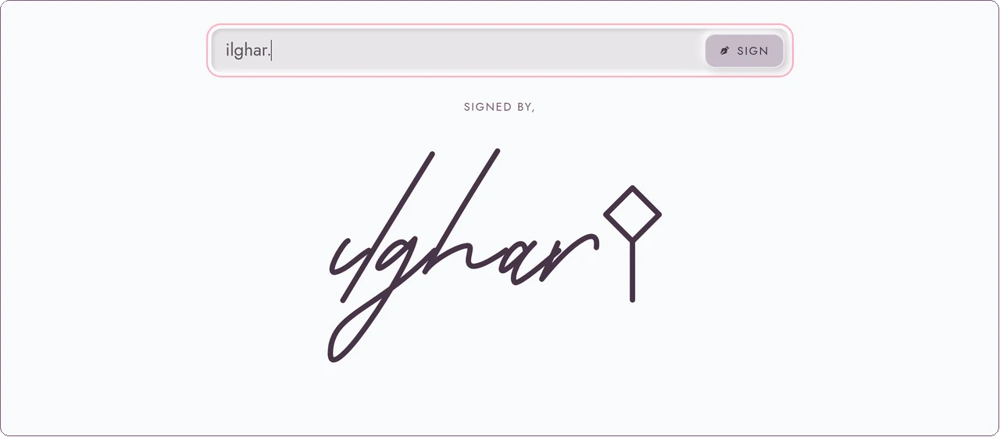
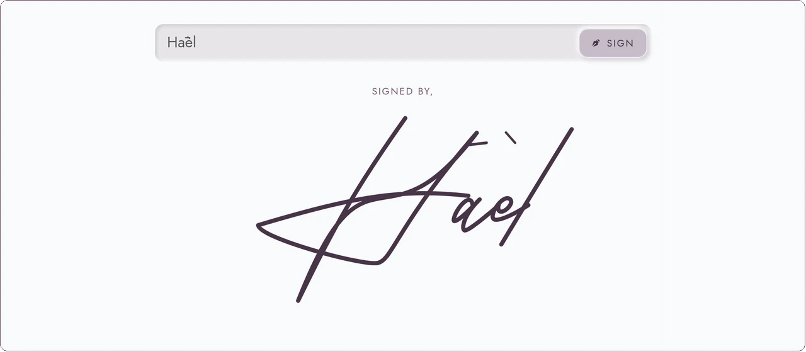

  <a href="https://ilghar.github.io/Signature-animation/">
    <picture>
      <source media="(prefers-color-scheme: dark)" srcset="docs/hero/hero-dark.webp">
      
    </picture>
  </a>

A signature you type, so each letter can be traced as an SVG stroke, signed, and downloaded.

<a href="https://ilghar.github.io/Signature-animation/">Open the live app</a> · <a href="https://github.com/Ilghar/Signature-animation">Repository</a> · <a href="https://ilghar.studio">ilghar.studio</a>

| <picture><source media="(prefers-color-scheme: dark)" srcset="docs/hero/f1-dark.webp"></picture> | <picture><source media="(prefers-color-scheme: dark)" srcset="docs/hero/f2-dark.webp"></picture> |
|---|---|

## How it works

- Type or paste a name. The default Hand-traced bank (and Relief SingleLine) draws each stroke; Allura, Great Vibes, Dancing Script and Caveat wipe in from the left.
- Sign (or Enter) replays the full name. Accents such as ā and è are drawn; unknown characters show a placeholder instead of disappearing.
- Download a transparent SVG, PNG (2× or 4×) or PDF of the paths, or copy the inline SVG and `` snippets. In Word, Google Docs or Photoshop, insert the SVG or PNG as a picture.

ilghar.studio
